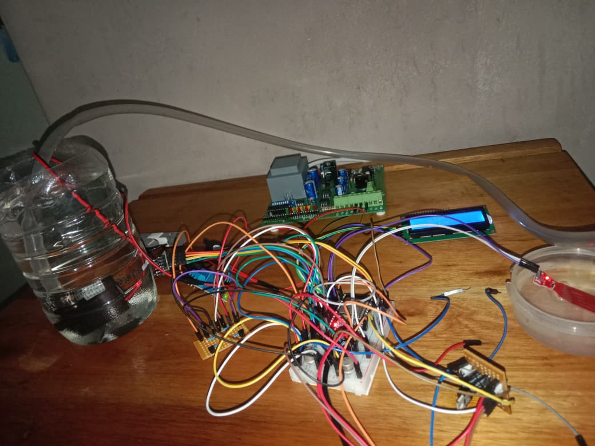
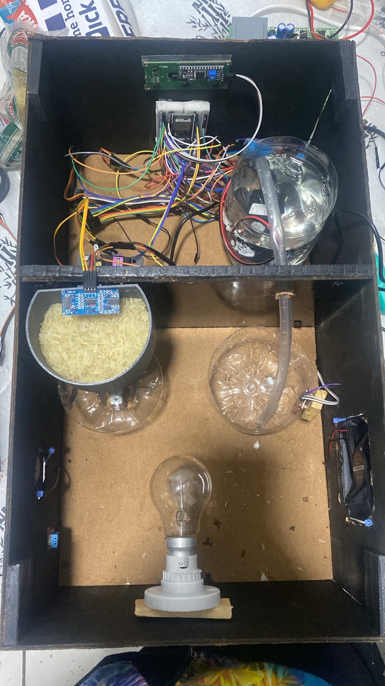

# Smart Poultry Enclosure: Water Monitoring and Dispensing Subsystem

An ESP32-based subsystem that keeps a poultry drinking dish supplied with water. It monitors the water level in the dish and the amount of water left in the reservoir, refills the dish automatically with a relay-controlled pump, protects the pump from running dry, and sounds an alarm when the reservoir needs refilling.

This was developed as part of **Group 2's Smart Poultry Enclosure** project (Electronic Design Project 3A, EDPA301, Durban University of Technology, February to June 2026). The wider enclosure also includes feed, temperature and manual-control subsystems. **This repository covers the water monitoring and dispensing subsystem only.**

## How it works

- **Dish level:** a water level sensor in the 100 mL drinking dish gives an analog reading that the ESP32 converts to a percentage of the operating range.
- **Refill control:** the pump switches ON when the dish level falls below 20% and OFF at 80%. Using separate ON and OFF thresholds (hysteresis) prevents the pump from switching rapidly and stops the dish overflowing.
- **Reservoir level:** the 500 mL reservoir sits on a load cell read through an HX711 amplifier. The ESP32 converts the measured weight to a percentage of reservoir capacity.
- **Dry-run protection and alarm:** below 20% reservoir level the pump is disabled, the buzzer sounds, and a warning is shown on the LCD.
- **Display and remote monitoring:** a 16 × 2 I2C LCD shows reservoir level, dish level, pump status and alarms. Level and status data are also sent to Firebase over Wi-Fi.

## Hardware

| Component | Purpose |
|---|---|
| ESP32 | Main controller |
| Water level sensor (dish) | Dish water level |
| Load cell + HX711 | Reservoir weight measurement |
| Relay module | Switches the pump from the 12 V supply |
| 12 V DC submersible pump | Moves water from reservoir to dish through PVC tubing |
| Buzzer | Low-water alarm |
| 16 × 2 I2C LCD | Local status display |
| 100 µF capacitor across the pump | Suppresses pump switching noise |

The pump runs from 12 V, the relay, HX711 and LCD from 5 V, and the ESP32 and water level sensor from 3.3 V, with a common ground. The reservoir is mounted on the load cell on a wooden support that lets the cell deflect freely.

## Software

Written in C++ using the Arduino IDE. On start-up the ESP32 initialises all peripherals, then loops: read both sensors, convert to percentages, apply the thresholds, drive the relay and buzzer, and update the LCD and Firebase.

<!-- TODO: upload your .ino source file and link it here. -->

## Test results

Components were tested individually (supply voltages, sensor response, known masses on the load cell, relay and pump switching) and then as a complete subsystem.

**Water level sensor calibration** (dish operating range 20 to 80 mL):

| Water in dish | ADC reading | Calculated level |
|---|---|---|
| 20 mL | 400 | 20% |
| 40 mL | 733 | 40% |
| 60 mL | 1067 | 60% |
| 80 mL | 1400 | 80% |

**Load cell calibration** (readings include the 77 g submersible pump):

| Water in reservoir | Expected total | Measured | Error |
|---|---|---|---|
| 0 mL | 75 g | 77 g | +2 g |
| 100 mL | 175 g | 180 g | +5 g |
| 250 mL | 325 g | 331 g | +6 g |
| 400 mL | 475 g | 473 g | −2 g |
| 500 mL | 575 g | 578 g | +3 g |

Load cell readings stayed within 6 g of the expected value across the 0 to 500 mL range.

**Control behaviour:** the pump started when the dish was low, stopped at the upper threshold, and was disabled when the reservoir fell below 20%. The pump responded about 1 to 2 seconds after the water level changed, which comes from sensor sampling, processing and relay switching. No false triggering was observed.

## Challenges and fixes

- **Unstable load cell readings:** caused by small shifts in how the reservoir sat. Fixed by reinforcing the wooden support and loading the cell directly above its sensing element.
- **Electrical noise from the pump:** disturbed sensor readings when the pump switched. Fixed by adding a 100 µF capacitor across the pump terminals and keeping the sensor wiring short.

## Limitations and future work

- The reservoir cannot refill itself, so it needs manual refilling when the alarm sounds.
- Remote monitoring depends on a stable Wi-Fi connection.
- Sensor accuracy is affected by vibration, water movement and noise.
- Possible improvements: more accurate sensors, automatic reservoir refilling, battery backup for power outages, and tuning the control algorithm to reduce response time.

## Author

Nontsikelelo Fundiswa Linda, BEng Tech Electronic and Computer Engineering, Durban University of Technology. Water monitoring and dispensing subsystem of Group 2's Smart Poultry Enclosure.
